# SOMA Vision Metrology 用户指南

**See Once, Measure All · 视觉轮廓与对位量测平台**

适用范围：V2.6.0 功能及 UI 打磨版。面向生产操作员、工艺工程师与测量工程师。

本指南按功能组织；第一次使用可先完成第 3 章的演示流程，再按任务查阅各章。截图来自本项目实际运行的 PySide6 界面，使用公开演示图像，在 Linux 上渲染，**不是界面设计稿**。Windows 的字体、文件选择框及间距可能不同。示例参数与结果只用于教学，不代表设备精度或产品验收标准。

> [!IMPORTANT]
> **先确认四件事，再相信测量值：正确的图像、正确的像素标定、正确的基准/待测轮廓、通过识别质量检查。** 显示很多小数位不等于具有相应测量准确度。

## 目录

- [1. 启动与权限](#start)
- [2. 认识工作区](#workspace)
- [3. 第一次测量：用演示数据跑通流程](#quickstart)
- [4. 图像导入与查看](#images)
- [5. 配方管理与正式发布](#recipes)
- [6. 手动 ROI 与轮廓识别](#roi)
- [7. 自动识别与轮廓选择](#auto)
- [8. 标定、算法与质量门槛](#calibration)
- [9. 对位偏差、判定与 Rz](#alignment)
- [10. 几何工具与尺寸测量](#geometry)
- [11. 批量测量与重复性](#batch)
- [12. 结果表与报告导出](#export)
- [13. 灰度剖面与成像诊断](#diagnostics)
- [14. 数据追溯、恢复与备份](#traceability)
- [15. 常见问题](#faq)
- [16. 操作速查与生产检查清单](#checklist)

## 1. 启动与权限

### 1.1 启动软件

**已安装 Windows 版本：** 使用安装程序创建的开始菜单或桌面快捷方式打开 SOMA Vision Metrology。

**使用源码版本：** Windows 下双击仓库根目录的 `start_overlay_measure.bat`。首次启动会创建独立 Python 环境并安装依赖，需要预先安装 64 位 Python 3.10–3.13，且能访问 Python 软件源。开发环境也可按仓库首页的说明安装依赖后运行 `python main.py`。

启动后默认进入**生产模式**。屏幕空间不足时可先最大化窗口；可拖动窗口边缘调整大小，双击标题栏切换最大化/还原。

### 1.2 生产模式与工程模式

| 模式 | 适合谁 | 主要用途与限制 |
| --- | --- | --- |
| 生产模式 | 现场操作员 | 加载受控配方、导入图像、运行、查看与导出；ROI 和算法配置锁定 |
| 工程模式 | 授权工程师 | 建立/修改配方、编辑 ROI、调参、几何配置、诊断及结果排除；切换时验证密码 |

进入工程模式：点击标题栏的模式下拉框 → **工程模式** → 输入管理员提供的密码。退出时切回**生产模式**。

> [!WARNING]
> **首次部署必须更改默认工程密码。** 初始设置见仓库首页或首次启动提示；正式产线应由负责人管理。工程模式下进入 **① 产品信息 → 修改工程模式密码**，输入当前密码，再两次输入新密码（至少 6 个字符）。不要把工程密码写进共享配方或测量报告。

### 1.3 生产运行的前置条件

必须已加载配方，且配方为**已验证 / 正式生产**、SHA256 校验通过；**物料编码**和**操作人员**不能为空。批量任务还需通过上下层配对检查。

条件不满足时，程序会弹出“计算前检查未通过”，列出待处理项。应修正对应问题，不要通过切换工程模式来绕过正式生产要求。

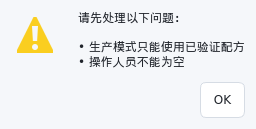

*图 1　示例：配方仍为草稿且未填写操作人员时，生产模式拒绝运行并列出原因。*

## 2. 认识工作区

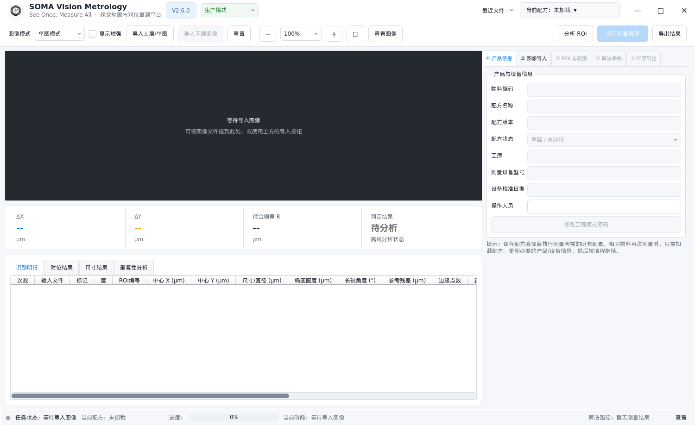

*图 2　启动后的生产模式。未导入图像时，画布提示导入或拖入文件。*

| 区域 | 位置 | 用途 |
| --- | --- | --- |
| 模式与配方 | 最上方标题栏 | 切换生产/工程模式；最近文件；当前配方快捷菜单 |
| 命令栏 | 标题栏下方 | 单/双图模式、导入、重置、缩放、运行与导出；工程模式增加分析和诊断入口 |
| 图像工作区 | 左侧上半部 | 查看图像、建立/编辑 ROI、选择轮廓和几何要素 |
| 汇总卡片 | 图像下方 | ΔX、ΔY、综合偏差 R 和当前判定 |
| 结果页签 | 左侧下半部 | 识别明细、对位结果、尺寸结果、重复性分析 |
| 参数面板 | 右侧 | ① 产品信息、② 图像导入、③ ROI 与轮廓、④ 算法参数、⑤ 结果导出 |
| 状态栏 | 最下方 | 任务状态、进度、当前阶段和算法路径 |

**小窗口中的文案变化：** “运行测量程序”可能简写为“运行”，“成像诊断”可能显示为“诊断”。工程模式最窄布局会将增强、适应窗口或重置的快捷入口收进**更多**菜单，并不是功能消失。

右侧页签内容较长时在面板内滚动；点击带箭头的分节标题可展开/折叠。结果表列较多时，使用表格底部横向滚动条。

## 3. 第一次测量：用演示数据跑通流程

**目标：** 不改算法，完成“加载配方 → 导图 → 测量 → 查看 → 导出”。请在演示环境操作。

准备仓库 `sample_data/` 中的三个文件：

- `demo_recipe.json`
- `sample_upper.png`
- `sample_lower.png`

### 操作步骤

1. 切换到**工程模式**。
2. 点击标题栏 **当前配方 → 从文件导入…**，选择 `demo_recipe.json`。本次演示选择**仅本次加载**即可；也可选择“导入并加入配方库”。
3. 确认命令栏为**双图模式**。在 **③ ROI 与轮廓** 中确认当前 Mark 为 **Mark1**，工作方式为**手动 ROI 测量**。
4. 点击**导入上层/单图**，选择 `sample_upper.png`；点击**导入下层图像**，选择 `sample_lower.png`。
5. 检查上下画布的 ROI 是否分别覆盖圆孔。配方包含的 ROI 不会因为换图而自动适应任意新目标。

   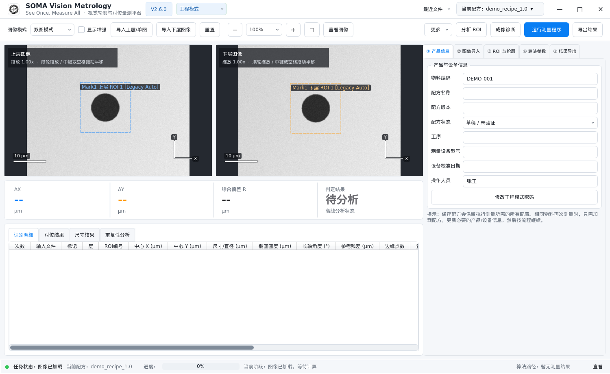

   *图 3　运行前：上下层 ROI（虚线框）应各自包住目标；右侧 ① 产品信息显示物料、配方状态和操作人员。*

6. 点击**运行测量程序**。如出现“确认配方 ROI”，检查列出的 Mark/层后确认使用；不正确则取消并修正。
7. 等待进度完成，检查汇总卡片及**识别明细 / 对位结果**。示例配方为未验证配方，判定显示**试测**是预期行为。
8. 点击**导出结果**，选择 Excel（`.xlsx`），保存后打开报告核对内容。

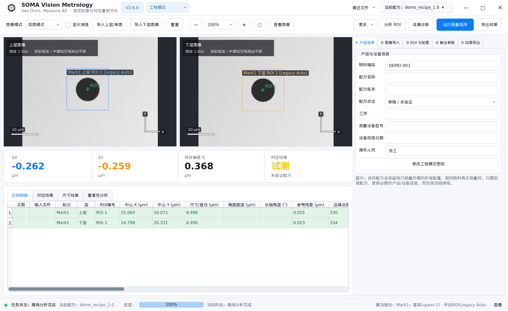

*图 4　使用原始演示配方的真实运行结果。图中 ΔX、ΔY、R 仅用于说明结果位置，不是校准基准。*

> [!IMPORTANT]
> **“试测”不等于“通过”。** 草稿/未验证配方可供工程调试，但不能据此签发正式合格结论。后续卡尺圆、几何和诊断示例使用了不同 ROI 设置，数值不必与此图相同。

## 4. 图像导入与查看

### 4.1 单图、双图与 Mark

- **单图模式：** 一个画布；使用“导入上层/单图”。下层导入按钮禁用属于正常状态。同一图像中可以识别多个轮廓并选出基准/待测对象。
- **双图模式：** 分别导入上层与下层；左右画布对应两层。不要仅根据文件名猜测层别，应核对图像内容。
- **Mark1 / Mark2：** 两个独立测量位置，每个 Mark 可以有上下层图像与多组 ROI。普通单位置任务可只使用 Mark1；计算 Rz 时需要两个 Mark。

支持 PNG、JPG/JPEG、BMP、TIF/TIFF，以及 NPY、CSV、TXT 矩阵文件。矩阵应是程序可读取的数值图像数据，不是普通测量结果表格。

### 4.2 三种导入入口

1. **顶部按钮：** 导入到当前 Mark 的对应图层。
2. **拖放：** 将一个本地图像文件拖到画布；双图按落点决定上/下层。计算中不能拖入。
3. **最近文件：** 标题栏菜单按层显示近期文件。记录存放在本机，并不跟随配方一起传给他人。

**检查导入是否成功：** 画布显示新图，**② 图像导入** 的文件来源更新；必要时核对父文件夹与文件名。

> [!CAUTION]
> **换图后必须重新测量。** 更换图像、配方、ROI 或关键参数会使旧识别/测量结果失效。不要把上一张图的结果当作当前图结果。

### 4.3 缩放、平移与独立查看

| 操作 | 方法 |
| --- | --- |
| 放大/缩小 | 命令栏 `+ / −`、百分比下拉框；或在画布上滚轮缩放 |
| 平移图像 | 中键拖动；或按住空格后左键拖动 |
| 恢复全图 | 命令栏 `□`（适应窗口）；工程模式也可从“更多 → 适应窗口”进入 |
| 单独放大查看 | 点击“查看图像”，打开可调整大小的独立窗口 |
| 增强可视性 | 勾选“显示增强”；紧凑工程布局也可在“更多”菜单切换 |

双图模式下命令栏缩放同步作用于上下层。**显示增强只辅助观察，不替代原始数据，也不是标定或算法调参。** 独立查看器用于查看，ROI 编辑仍在主窗口完成。

## 5. 配方管理与正式发布

配方（Recipe）保存测量配置：图像模式、ROI、标定、算法与质量门槛、规格、轮廓选择及已配置的几何测量程序。它**不是原始图像和测量报告的打包文件**。

### 5.1 快速加载与文件导入

点击标题栏**当前配方**打开快捷菜单；搜索配方名称、物料编码或版本，双击条目加载。

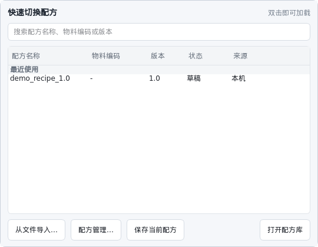

*图 5　配方相关操作集中在标题栏“当前配方”菜单中。*

工程模式导入 JSON 时，有两种选择：

| 选项 | 行为 | 适用场景 |
| --- | --- | --- |
| 导入并加入配方库 | 复制到本机配方库，便于后续搜索加载 | 经常使用或准备管理的配方 |
| 仅本次加载 | 使用原文件，不复制到库 | 临时查看、演示或工程试验 |

加载其他配方前，请先保存仍需保留的当前配置。

### 5.2 本机库、共享库与收藏

从**当前配方 → 配方管理…**进入。可按名称/物料/版本搜索，筛选来源，选择条目后加载或切换收藏。

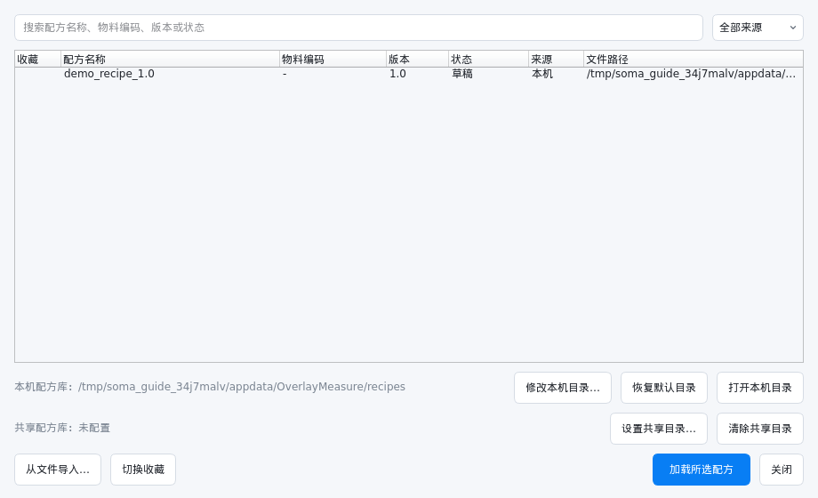

*图 6　配方管理窗口。工程模式可修改本机目录、设置共享目录。*

修改本机库位置应使用管理窗口中的**修改本机目录…**，让程序处理相关迁移；共享目录适合团队分发受控配方。目录访问权限、备份和版本发布规则仍需由团队管理。

### 5.3 保存与正式发布

1. 工程模式下配置并验证测量流程。
2. 在 **① 产品信息** 填写物料编码、配方名称/版本、工序、设备信息等。
3. 调试阶段保留**草稿 / 未验证**。完成团队要求的验证和审批后，再设为**已验证 / 正式生产**。
4. 点击 **当前配方 → 保存当前配方**，确认保存位置。程序同时生成 SHA256 侧车文件（例如 `recipe.json.sha256`）。
5. 切回生产模式，从配方库重新加载，核对版本、标定、操作人员并进行生产前检查。

> [!WARNING]
> **“已验证”是工程师声明，不是软件自动证明测量正确。** SHA256 校验用于发现文件内容变化，不等于可信发布者认证，也不能替代校准、工艺验证或审批。分发时保留 JSON 及对应 `.sha256` 文件；不要手工修改 JSON 后沿用旧校验文件。

## 6. 手动 ROI 与轮廓识别

ROI 是用于寻找目标的**感兴趣区域**。ROI 边框不是最终测得的边缘；绿色识别轮廓才是后续测量引用的对象。

### 6.1 建立和编辑 ROI

前提：工程模式、图像已导入、没有正在运行的计算。

1. 进入 **③ ROI 与轮廓**，选择正确的 **Mark编号 / 当前层**。
2. 工作方式选择**手动 ROI 测量**，在 ROI 参数区选择类型。
3. 在画布空白处左键拖动，新建包围目标的 ROI。
4. 单击已有 ROI 先选中；选中后从内部拖动可移动，通过控制点调整大小。
5. 空白单击或按 `Esc` 取消选择。右键可复制、删除此 ROI，或按层清理。
6. 点击**分析 ROI**，检查当前 Mark 上下层的识别结果；需要执行完整测量时点击**运行测量程序**。

> [!IMPORTANT]
> **先选中，再编辑；先确认 Mark/层，再画 ROI。** 修改 ROI 会使它的旧识别和关联测量失效。删除/清理前确认作用范围，尤其是“删除当前层全部 ROI”和“清除所有识别与测量轮廓”。

### 6.2 如何选择 ROI 类型

| 类型 | 主要用途 | 设置重点 |
| --- | --- | --- |
| 矩形区域 | 常规局部目标搜索 | 尽量排除相邻目标与杂散边缘 |
| 圆形区域 | 圆孔、圆形目标 | 包含完整目标边界，不要混入另一同心边界 |
| 椭圆区域（计算圆度） | 椭圆目标及长短轴差评价 | 包含完整外形，检查旋转轮廓是否贴合 |
| 卡尺圆 | 沿圆周搜索边缘并拟合 | 环带覆盖目标边缘；设置数量、宽度、方向、目标边缘 |
| 圆环区域 | 在内外半径之间搜索 | 内外半径限定目标环，避免选错内外边 |
| 矩形环区域 | 矩形/方孔的环状搜索范围 | 检查内外边界及矩形环角度 |
| 近似直线 | 直线边缘 | 框定局部直边，避免拐角和其他轮廓 |
| 区域中心区域 / 稳健轮廓中心区域 | 区域或轮廓中心估计 | 按目标定义选择，不要把中心模型与圆直径模型混用 |

### 6.3 卡尺圆的操作例子

1. 选**卡尺圆**，在孔周围创建 ROI。
2. 调整内、外半径，使真实边界落在环带内。
3. 设置卡尺数量/宽度，选择**由内向外**或**由外向内**；根据目标选择最强、靠内或靠外边缘。
4. 运行分析，查看绿色轮廓是否沿目标边界、覆盖是否充分、有无错抓亮环或光晕。
5. 点击已拟合轮廓可查看卡尺，点击空白处隐藏；结合“显示诊断信息”和质量列检查，而不是只看最终数字。

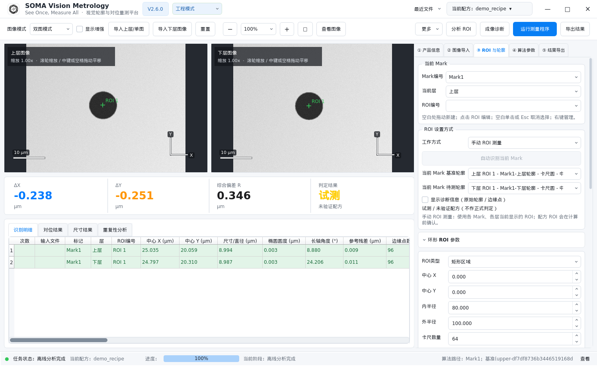

*图 7　同一演示图像改用卡尺圆后得到的结果，与原演示配方的中心模型不是同一算法口径。*

**多个 ROI：** 同一 Mark/层可建立多个 ROI，通过“ROI编号”或点击画布选择。每个 ROI 独立保存识别状态；一个失败不代表其他成功轮廓无效。

## 7. 自动识别与轮廓选择

自动识别适合在图像中寻找候选目标；它不免除标定、目标选择和质量检查。

### 标准流程

1. 工程模式下进入 **③ ROI 与轮廓 → 工作方式 → 自动识别测量**。
2. 按希望的精测外形选择当前 ROI 类型；自动候选会结合所选类型进行精测。
3. 点击**自动识别当前 Mark**，等待后台任务结束。
4. 观察画布的候选编号，并在下拉框选择**当前 Mark 基准轮廓**与**当前 Mark 待测轮廓**。
5. 点击**计算所选轮廓对位偏差**，或执行顶部完整测量程序；检查结果与提示。

候选显示编号按空间位置由上到下、从左到右组织；单图为数字，双图区分上/下层。**不要把编号当作质量排名，也不要默认第一个候选就是目标。**

### 候选太多或找错目标

进入 **④ 算法参数 → 自动识别高级规则**，按实际目标设置基准/待测的预期外形、尺寸上下限和拟合方式。先排除错误目标，再调质量参数。

> [!WARNING]
> **基准与待测必须是两个正确且不同的对象。** 顺序会影响偏差方向；选择失败、ROI 变化或对象消失后，应重新确认。不要仅为了得到预期数值而更换基准或放宽规则。

## 8. 标定、算法与质量门槛

入口：工程模式 → **④ 算法参数**。建议顺序为：**标定 → ROI/目标 → 基础识别 → 质量检查 → 规格确认**。

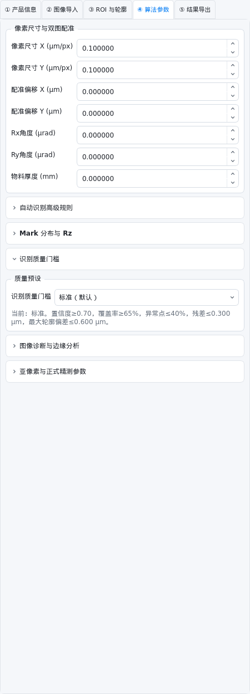

*图 8　④ 算法参数：顶部为像素尺寸与双图配准，下方为可折叠的高级规则、Rz、质量门槛、灰度诊断和亚像素参数。*

### 8.1 像素尺寸与双图配准

| 参数 | 单位 | 含义与使用注意 |
| --- | --- | --- |
| 像素尺寸 X / Y | μm/px | 每个方向的像素对应物理尺寸；来自实际设备标定，可不相等 |
| 配准偏移 X / Y | μm | 双图配准修正；只使用有依据的标定值，不应拿来“归零”真实缺陷 |
| Rx / Ry 角度 | μrad | 与物料厚度共同参与倾斜补偿；不是角度“度” |
| 物料厚度 | mm | 倾斜补偿所用厚度；注意与 μm 区分 |

> [!CAUTION]
> **像素标定错误会影响尺寸、距离和偏差。** 换镜头、倍率、相机分辨率或采集流程后，应确认原标定是否仍适用。示例中的 `0.1 μm/px` 不是通用默认正确值。

### 8.2 常用算法参数

| 参数组 | 用途 | 调整建议 |
| --- | --- | --- |
| 高斯滤波 Sigma | 抑制灰度噪声 | 过强可能模糊细边，先看原始剖面 |
| Canny 低/高阈值、最小梯度 | 筛选边缘响应 | 找不到边缘时检查对比度与曝光，不要直接降到极低 |
| 剖面半宽、步长 | 控制采样范围和间隔 | 更密采样不等于更高真实精度 |
| RANSAC、剔除阈值 | 剔除偏离模型的点 | 结合剔除比例、覆盖率检查是否丢弃了真实结构 |
| 最少边缘点数 | 最低有效数据要求 | 点少时优先检查 ROI 是否完整、边缘是否清晰 |
| 边缘极性 | 自动、暗到亮、亮到暗 | 按搜索方向上的真实灰度变化选择 |
| 自动搜索半宽 | 自动正式精测搜索范围 | 应覆盖可能的真实边缘，但避免跨入邻近边界 |
| 任务超时 | 限制计算持续时间 | 超时先检查图像、目标数量和 ROI 范围 |

参数对不同算法路径的作用并不完全相同。可在状态栏**算法路径 → 查看**中核对实际采用的处理路径。

### 8.3 质量门槛与尺寸规格是两层检查

- **识别质量门槛：** 检查结果是否可靠。预设为“标准”“宽容”“超精确”；详细项包括置信度、覆盖率、异常点比例、残差和轮廓偏差。
- **判定规格：** 在 **⑤ 结果导出** 设置 `|ΔX|`、`|ΔY|`、`R` 上限，判断可靠结果是否满足产品要求。

> [!WARNING]
> **低残差不必然代表找对边；尺寸未超限也不代表识别有效。** 不要通过放宽质量门槛把“无效”变成合格。参数修改后重新测量，并按团队流程验证、保存新版本配方。

## 9. 对位偏差、判定与 Rz

### 9.1 读懂 ΔX、ΔY 和 R

- ΔX / Dx：所选对象之间的 X 向偏差，单位 μm。
- ΔY / Dy：Y 向偏差，单位 μm。
- R / Dxy：二维偏差大小，即 `√(ΔX² + ΔY²)`。
- 正式输出坐标采用 **X 向右为正、Y 向上为正**。底层图像像素 Y 向下，不能直接照搬像素坐标差的符号。

基准/待测轮廓流程按**待测相对基准**计算，并考虑配置的配准与补偿。解释正负号前，先核对结果记录中的基准与待测名称，不要仅根据“上层/下层”猜测方向。

### 9.2 判定状态

| 状态 | 意义 | 下一步 |
| --- | --- | --- |
| 通过 | 当前有效结果满足已配置规格 | 按流程复核、导出与归档 |
| 超限 | 有效测量超过规格 | 核对输入与配置；按质量流程处理 |
| 无效 | 识别质量不满足要求 | 查 ROI、边缘、覆盖率和质量详情；不能作为合格结论 |
| 异常 | 计算/输入等出现错误 | 查看提示、错误原因和日志 |
| 试测 | 配方未验证，不作正式判定 | 用于工程调试，完成验证后再发布 |

汇总卡片便于快速查看；多 Mark、批量及排障时，必须同时查看底部的**对位结果**、**识别明细**和提示列。

### 9.3 用两个 Mark 计算 Rz

1. 分别准备 Mark1、Mark2 的图像和正确轮廓选择。
2. 在 **④ 算法参数 → Mark 分布与 Rz** 选择实际分布方向，填写 **Mark间距 L（μm）** 和 `|Rz|` 上限（μrad）。
3. 运行完整测量，在对位结果中检查两个 Mark 及 Rz。

软件采用：Y 向前后分布时 `Rz = (Dx2 − Dx1) / L × 10⁶ μrad`；X 向左右分布时 `Rz = (Dy2 − Dy1) / L × 10⁶ μrad`。

**L 必须是实际间距，不是画面像素距离。** 两个 Mark 的任一输入或识别不可信时，不应据 Rz 单独签发结论。

## 10. 几何工具与尺寸测量

入口：工程模式 → **③ ROI 与轮廓**，向下滚动到“轮廓测量”分节，其中包含“几何工具”和“测量工具”。

### 10.1 优先使用已识别要素

绿色轮廓可以作为几何测量的引用。点击圆/椭圆轮廓时会吸附到中心；没有命中合法对象时，程序会提示，不会把空白点当成圆。

**手工几何工具**提供点、直线、圆、交点、中点和投影点。按工具提示在画布选点或选线；它们本身**不进行亚像素边缘识别**。

### 10.2 以测量直径为例

1. 先完成圆形目标识别，例如第 6 章的卡尺圆。
2. 确认当前 Mark/层，在“测量工具”点击**直径**。
3. 点击该层已识别圆的**绿色轮廓**，而不是孔内空白区域。
4. 查看图上的直径标注和底部**尺寸结果**。

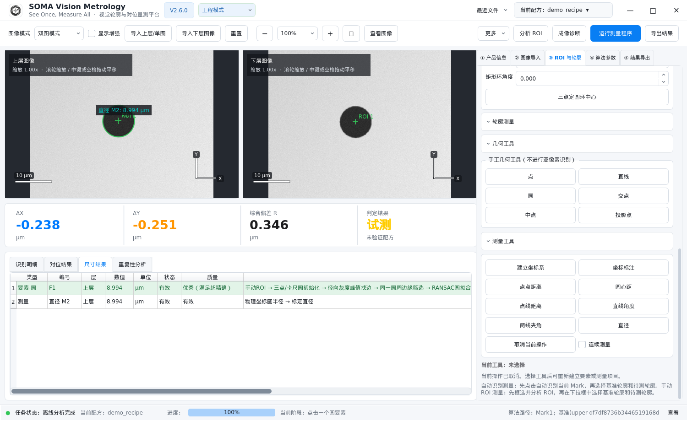

*图 9　直径测量实例。右侧为工具入口，图上显示标注，底部保存结果。*

### 10.3 测量工具选取顺序

| 工具 | 依次选择 |
| --- | --- |
| 点点距离 | 两个点或中心要素 |
| 圆心距 | 两个已识别/已建立的圆要素 |
| 点线距离 | 点或圆心，再选直线 |
| 直线角度 | 一条直线 |
| 两线夹角 | 两条直线 |
| 直径 | 一个圆要素 |

选点过程中按 `Backspace` 撤回上一个点，`Esc` 取消；勾选**连续测量**可重复同类操作。每次操作应在开始时选定的同一图层完成。

### 10.4 建立坐标系与坐标标注

点击**建立坐标系**，根据任务选择两圆心建轴、两点建轴，或点原点加直线轴；按照窗口及画布提示完成引用选择，必要时设置附加旋转。

点击**坐标标注**，选择所需坐标系，核对画布高亮轴后完成标注。几何物理坐标为 X 向右、Y 向上、逆时针为正，支持 X/Y 不同像素尺寸。

> [!IMPORTANT]
> **不要混淆两种角度口径。** 几何物理坐标角度与识别明细中的“长轴角度”不同：后者使用图像 Y 向下、顺时针为正，范围为 `[-90°, 90°)`；理想圆的长轴方向可能留空。

**椭圆圆度**按 `(物理长轴 − 物理短轴) / 2` 计算。它是本软件的长短轴差评价，**不是 ISO 最小区域圆度**。引用任何“圆度”数据前应确认报告口径。

保存当前配方可保留几何程序；源 ROI/识别要素被修改或删除后，相关尺寸可能失效，需要重新识别或重建引用。

## 11. 批量测量与重复性

入口：**② 图像导入 → 批量测量导入**。

### 11.1 导入与运行

1. 将“测量方式”切换为**批量测量**。
2. 选择导入来源：**选择图片 / 选择文件夹 / 选择多个文件夹**；需扫描下级目录时勾选“含子目录”。
3. 分别点击对应 Mark 的**追加 M1 上层/单图、追加 M1 下层**等按钮。多个文件夹窗口可使用 `Ctrl / Shift` 多选。
4. 检查导入表中的上层/下层数量、配对状态。双图应显示“若干组已配对 / 就绪”；只有 Mark1 有任务时，Mark2“未导入”不代表错误。
5. 通过命令栏 `‹ / ›` **批量预览**逐组检查图像与 ROI。
6. 点击**运行测量程序**。需要停止时，点击进度条旁的**取消计算**，等待程序结束当前算法步骤。
7. 在识别明细的“批次明细”选择单次记录或“全部”，并查看重复性分析。

> [!CAUTION]
> **数量相等不等于配对正确。** 双图按导入列表顺序逐张配对，不是按工件 ID 智能匹配。导入流程会处理排序/去重，但跨文件夹分次追加仍需人工核对顺序；务必逐组预览。上下数量不一致，或同一组上下层使用同一个文件，都会被运行前检查拦截。

### 11.2 读取重复性结果

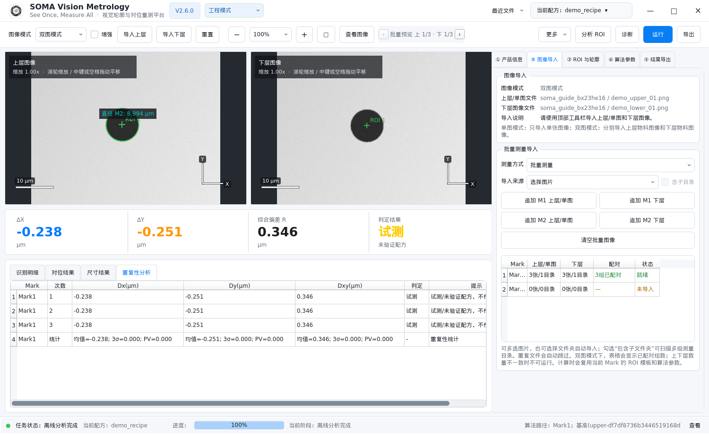

*图 10　为演示界面，将同一组公开样例复制成三个不同路径后运行，故图中 3σ/PV 为零。这不是设备重复性试验。*

- **均值：** 参与统计的偏差平均值。
- **3σ：** 三倍样本标准差，用于描述这批数据的离散程度；有意义的重复性评估需要足够的独立重复采集。
- **PV：** 最大值减最小值。
- **“全部”批次明细：** 合并显示表格，画布仍保留最近一次单次预览；并不把全部图像叠加显示。

> [!IMPORTANT]
> **重复测量同一个文件不能验证设备重复性。** 正式评估需要按测量系统分析方案独立重新采集。还应检查失败/无效记录与参与统计的次数；不能只看汇总的均值或 3σ。

“清空批量图像”用于清理当前批量列表；更换批量输入前先导出要保留的结果。

## 12. 结果表与报告导出

### 12.1 四个结果页签

| 页签 | 主要内容 | 适合回答的问题 |
| --- | --- | --- |
| 识别明细 | 每次/Mark/层/ROI 的中心、尺寸、椭圆圆度、角度、质量、算法路径与提示 | 找对边了吗？哪一个 ROI 失败了？ |
| 对位结果 | Dx、Dy、Dxy/Rz、判定与质量详情 | 偏差是多少？是否满足规格？ |
| 尺寸结果 | 几何要素、坐标标注和尺寸、有效性及错误信息 | 哪个尺寸被测得？引用是否有效？ |
| 重复性分析 | 各次记录及均值、3σ、PV | 多次结果是否稳定？ |

### 12.2 复制、滚动与排除结果

表格支持拖选、`Ctrl / Shift` 多选、`Ctrl+A` 全选及复制；右键可选择包含表头的复制方式，便于粘贴到电子表格。列溢出时使用底部横向滚动条，或 `Shift + 滚轮` 横向浏览。

工程模式可右键删除结果；生产模式保持只读。

> [!WARNING]
> **删除结果会改变后续统计和导出，不只是隐藏一行。** 批量记录按完整测量次数排除，并重算统计；删除识别/几何要素也可能使依赖结果失效。正式质量报告若需排除异常，应保留原因与原始记录，不能为了“变绿”删数据。

### 12.3 选择正确的导出格式

点击顶部**导出结果**，选择文件类型与保存位置。

| 格式 | 包含内容 | 推荐用途 |
| --- | --- | --- |
| Excel `.xlsx` | 基础信息、结果汇总、识别明细；有对应数据时包含多次测量结果、尺寸结果和图像工作区 | 完整复核、交接与归档 |
| CSV `.csv` | 单一结果表；不包含完整多表报告、尺寸/重复性及图像 | 系统接口或简单表格交换 |

> [!CAUTION]
> **CSV 不能替代完整 Excel 报告。** 导出 CSV 时出现的限制提示应认真确认。要交付图像叠加、每次识别及尺寸信息，优先选 Excel。

导出后至少核对：配方/物料信息、输入文件、测量次数、基准/待测对象、单位、判定及图像工作区。报告成功保存不等于测量有效；“试测”“无效”等状态仍需保留。

## 13. 灰度剖面与成像诊断

两个入口用途不同，都在**工程模式**使用。

### 13.1 图像诊断与边缘分析：看单图灰度

1. 导入图像并选择当前层。
2. 点击 **更多 → 图像诊断与边缘分析**；也可从 **④ 算法参数 → 图像诊断与边缘分析 → 打开灰度剖面**进入。

   

3. **回到主窗口画布**，在目标边缘上拖动一条线。
4. 诊断窗口显示沿线灰度曲线及长度、最小值、最大值、均值、PV。

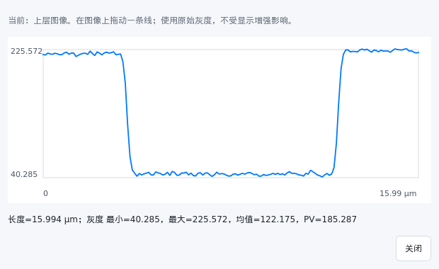

*图 11　横穿暗孔的剖面：两侧较亮，孔内较暗；用于观察对比度和边缘变化。*

剖面使用原始灰度，不受“显示增强”影响，也不会修改原图或正式结果。

### 13.2 成像诊断：比较两次成像的圆形轮廓

前提：主页面处于双图模式，已完成上下层**圆形轮廓**识别，例如使用卡尺圆。只有中心估计而没有所需圆形轮廓的结果，不能直接完成该比较。

1. 确认主页面当前 Mark、批次和上下层对象。
2. 点击工具栏**成像诊断**（小窗口简写为“诊断”）。程序自动带入主页面的图像和识别点，无需重新导图、画 ROI。
3. 有多个候选时确认比较对象；点击**自动配准**。
4. 切换**边缘叠加 / 局部位移 / 灰度梯度**。
5. 点击图像选择角度，或在曲线上定位，观察联动位置；需要时使用“适应窗口 / 局部放大”。

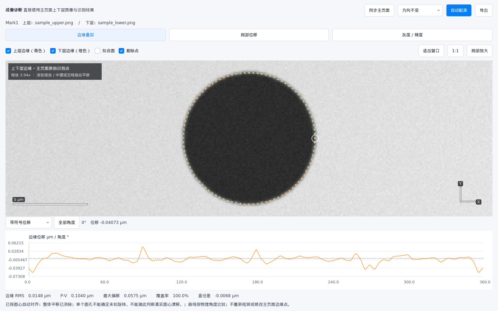

*图 12　青色为上层、橙色为下层；曲线按角度显示配准后的边缘差异。*

| 视图 | 用途 |
| --- | --- |
| 边缘叠加 | 比较主页面原生识别点、拟合圆和剔除点 |
| 局部位移 | 查看当前角度附近的位移短线；注意显示倍率 |
| 灰度 / 梯度 | 对比同一物理采样线上的原始/平滑灰度与梯度、候选峰 |

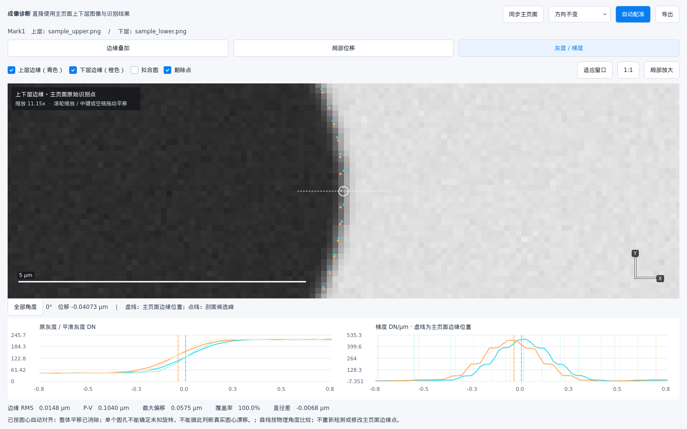

*图 13　灰度/梯度辅助解释边缘差异，不会运行第二套正式边缘识别。*

> [!WARNING]
> **自动配准会把两个圆心平移对齐，整体平移已经被消除。** 因此这里只能用于相对形状比较，不能用“重合得很好”证明真实对位偏移为零。未知旋转不能由单个理想圆可靠确定；已知扫描方向不同，才选择相应 90°/180°/270°旋转后重新配准。

### 13.3 同步、有效性与诊断导出

- 主页面换图、重新识别或切换批次后，点击**同步主页面**，再点**自动配准**；重新打开也会同步。
- 诊断使用只读快照，不修改主页面配方、原始检测点或 DX/DY。
- 覆盖不足、质量未通过或批量历史轮廓被抽样时，可能只允许预览。要做完整诊断，应对当前图组重新识别。
- 点击诊断窗口的**导出**，可保存完整精度 Excel/CSV、边缘点、逐角度差异、PNG 与会话信息；灰度/梯度视图还能保存当前剖面数据。

**比较对象必须有物理意义。** 不同结构之间的差异不能直接归因于设备变化；算法小数位数也不等于测量不确定度。更详细的口径见 [成像诊断说明](../diagnostics.md)。

## 14. 数据追溯、恢复与备份

Windows 默认用户数据目录为 `%LOCALAPPDATA%\OverlayMeasure`；Linux 默认位于 `~/.local/share/OverlayMeasure`。配方库可另行配置位置。

完成测量后，程序会创建测量 ID 和追溯档案，记录配方与参数快照、输入路径及哈希、结果等，位于用户数据目录的 `records/` 下。运行日志、未完成任务及最近文件记录也属于本机状态。

> [!IMPORTANT]
> **追溯档案不是完整原图备份。** 路径和文件哈希不能恢复丢失的图像；应另行保存原始图像、配方及校验文件、完整报告，并按团队保留期限备份。不要随意清理生产电脑的用户数据目录。

异常退出后，如启动时提示**恢复未完成任务**，可恢复配方及图像列表。确认文件仍可访问，检查当前配置，再重新运行；不能把恢复列表理解为已恢复一份完整有效的最终结果。

如果提示“追溯归档失败”，即使计算完成，也应处理目录权限、空间等问题并查看日志，不能假定追溯已保存。

## 15. 常见问题

| 现象 | 优先检查与处理 |
| --- | --- |
| 下层导入按钮灰色 | 是否为单图模式；这是预期权限状态 |
| 不能改 ROI / 算法 | 是否处于生产模式或计算中；需要授权工程模式并等待任务结束 |
| 生产模式拒绝运行 | 按弹窗逐项检查配方加载、已验证状态、校验、物料编码、操作人员和批量配对 |
| 只显示“试测” | 配方未验证；不要将其当作正式通过 |
| 有图但没有结果 | 确认正确 Mark/层、ROI 覆盖、工作方式、候选选择，并执行测量 |
| 识别到了错误亮环/同心边 | 缩小 ROI，调整内外范围和目标边缘；用灰度剖面确认边界 |
| 数值突然变化 | 检查图像、倍率/标定、基准顺序、ROI 类型、拟合模型、配准/倾斜补偿是否改变 |
| 直径工具点击无反应 | 应点合法圆/椭圆绿色轮廓，且与操作开始时同一层；中心估计区域不等同于圆要素 |
| 批量数量相同但结果错位 | 按预览序号核对上下层内容与追加顺序；数量一致只说明能配对 |
| 成像诊断没有可比较结果 | 主页面双图先识别上下圆形轮廓，确认当前 Mark/批次，再同步主页面 |
| 改参数后结果消失/失效 | 安全机制；重新运行，不应继续引用旧结果 |
| 导出文件失败 | 关闭 Excel 中正在打开的同名文件，检查路径权限、磁盘空间；可换文件名再试 |
| CSV 缺少尺寸或图片 | 格式限制；改导出 Excel |
| 表格列看不全 | 横向滚动或复制到表格软件，不必把列挤到无法阅读 |
| 想停止长任务 | 使用进度条旁“取消计算”，等待停止；避免直接强杀造成未完成任务 |

向维护人员反馈问题时，提供软件版本、操作模式、配方版本、报错文字、复现步骤及脱敏截图。真实物料图像和配方不要直接上传公开仓库。

## 16. 操作速查与生产检查清单

### 常用鼠标与键盘操作

| 操作 | 用途 |
| --- | --- |
| 空白处左键拖动 | 工程模式新建 ROI；几何/诊断工具激活时遵循其当前提示 |
| 单击 ROI → 再拖动 | 先选中，再移动或调整控制点 |
| 空白单击 / Esc | 取消 ROI/卡尺选择，或取消当前几何操作 |
| 中键拖动 / 空格 + 左键拖动 | 平移画布 |
| 滚轮 | 围绕光标缩放图像 |
| Backspace | 几何工具撤回上一个选点 |
| 右键 | ROI、轮廓/几何或结果表的上下文管理 |
| Ctrl / Shift | 表格多选；多个文件夹窗口的组合选择 |
| Ctrl+A / 复制 | 结果表全选及复制 |
| Shift + 滚轮 | 表格横向浏览 |

### 每次正式运行前

- [ ] 当前物料、配方名称及版本正确，已验证且校验通过。
- [ ] 操作人员已填写；设备/工序信息正确。
- [ ] 图像来自正确的 Mark 与上/下层，像素标定适用于当前采集条件。
- [ ] ROI、基准/待测对象与实际目标一致。
- [ ] 质量门槛和判定规格经过批准，没有为通过本次检查临时放宽。
- [ ] 批量任务逐组核对上下配对，而不仅核对数量。

### 完成后

- [ ] 核对进度和任务状态；检查每个 Mark/ROI 的错误或无效记录。
- [ ] 区分通过、超限、无效、异常与试测。
- [ ] 复核异常点排除及统计次数，保留排除依据。
- [ ] 导出并打开 Excel 检查；必要时另存诊断数据。
- [ ] 保存原图、受控配方、校验文件、报告及追溯记录。
- [ ] 完成工程调试后切回生产模式。

---

**相关资料：** [项目首页](../../README.md) · [成像诊断口径](../diagnostics.md) · [演示数据](../../sample_data/)
